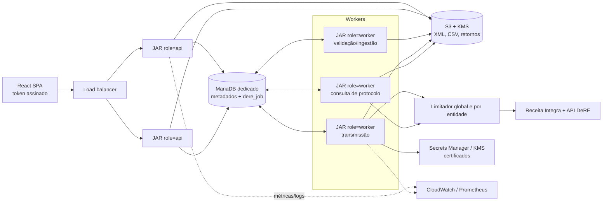
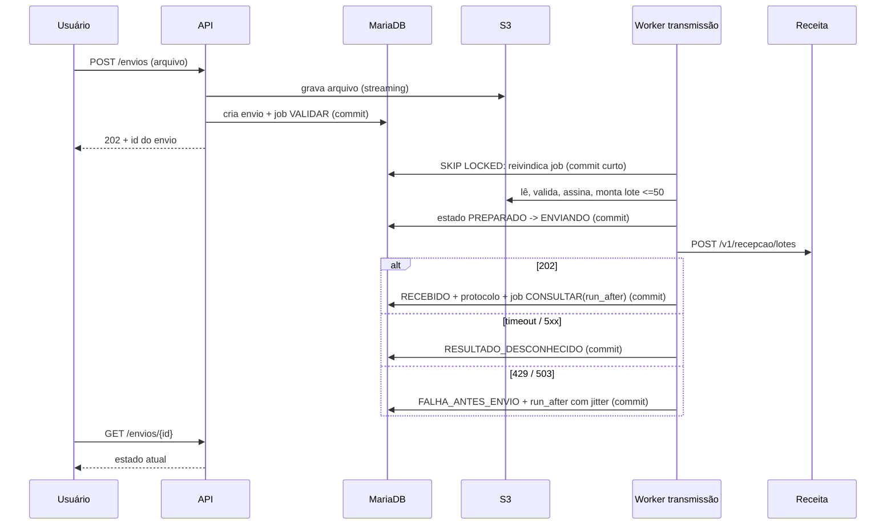

# Auditoria Arquitetural do DeRE — Escalabilidade, Alta Disponibilidade e Processamento Massivo

Data da análise: 22/10/2026. Base: working tree do repositório `dere` nesta data.

Este documento consolida, em um único arquivo, os seis entregáveis pedidos em `prompt-arquitetura.md`:

1. Arquitetura atual
2. Gargalos e riscos
3. Arquitetura proposta
4. Plano de evolução
5. Plano de testes de carga
6. Resumo executivo e respostas objetivas

Convenção de classificação usada em todo o texto:

- **CONFIRMADO**: evidenciado diretamente pelo código ou pela configuração versionada.
- **RISCO POTENCIAL**: inferência técnica fundamentada no código e no comportamento documentado do framework.
- **NÃO VERIFICADO**: depende de infraestrutura, documentação oficial ou medição que não está no repositório.

Nenhum número de capacidade deste documento foi medido. Esforços são faixas estimadas, não medições.

---

## 6. Resumo executivo (leia primeiro)

### Diagnóstico geral

A aplicação é uma POC funcional bem cuidada em pontos isolados (parsers DOM com DOCTYPE bloqueado, `HttpClient` reutilizado, cache de token, `@Version` no lote, unicidade do id do evento, senha de certificado em Secrets Manager). Ela **não está preparada para grandes entidades nem para comercialização**, e os bloqueios principais não são de capacidade: são de **segurança e consistência**.

Os três problemas mais graves, todos CONFIRMADOS:

1. **Não há autenticação real.** Toda autorização depende dos headers `X-User-Id` e `X-Entity-Id`, que o cliente escolhe livremente. Basta enviar `X-User-Id` de um usuário master para acessar e alterar qualquer entidade. Há ainda endpoints sem checagem alguma, inclusive um que devolve XML e CSV de auditoria de qualquer entidade.
2. **O scheduler de consulta marca lotes reais como aceitos com recibo falso.** `TransmissaoPollingService` chama sempre `LocalDereFlowService.query`, que grava `ACEITO` e recibo `REC-<id>` sem consultar a Receita. Em homologação, onde o adaptador real é forçado, um lote transmitido de verdade vira "aceito" localmente em cerca de 30 segundos, e a consulta manual passa a devolver o recibo falso sem chamar a Receita.
3. **A transmissão chama a Receita dentro de uma transação de banco.** Timeout ou falha local depois do envio desfaz o registro local do evento, apagando a evidência de que o lote pode ter sido recebido. O usuário consegue reenviar, contrariando a orientação do manual do desenvolvedor.

Na capacidade, o desenho é síncrono de ponta a ponta. Um lote leva sempre um único evento, embora o XSD aceite 50. Uploads e validações rodam inteiros em memória dentro da thread HTTP. O XSD é recompilado a cada validação. Arquivos grandes vão para disco local e consultas varrem todos os eventos da entidade.

### Capacidade comprovada versus desconhecida

| Item | Situação |
|---|---|
| Capacidade de usuários simultâneos | NÃO VERIFICADO. Não há teste de carga no repositório. |
| Throughput de validação XSD | NÃO VERIFICADO. Há indício forte de desperdício (XSD recompilado a cada chamada). |
| Limites da Receita (lote, tamanho, frequência) | NÃO VERIFICADO. Os manuais dizem que serão divulgados. Só o XSD de lote fixa 50 eventos. |
| Idempotência na Receita (`Idempotency-Key`) | NÃO VERIFICADO. O header é enviado, mas nenhum manual o menciona. |
| Operação com mais de uma instância | CONFIRMADO que não é segura hoje (disco local, scheduler sem coordenação real, lease inefetivo). |

### Recomendações prioritárias

As obrigatórias para segurança e consistência vêm antes de qualquer ganho de capacidade:

1. Autenticação real com Spring Security e token assinado, e autorização por entidade derivada do token, nunca de header.
2. Remover ou isolar por perfil o caminho mock em ambientes reais e corrigir o scheduler para consultar a Receita.
3. Tirar a chamada HTTP da transação e persistir a intenção de envio antes de chamar a Receita, com estado explícito de resultado desconhecido.
4. Separar a infraestrutura de produção da de staging e homologação (hoje é a mesma EC2 e o mesmo MariaDB).
5. Migrations Flyway completas (hoje há colunas e tabelas criadas por script manual).

Depois vêm os itens de capacidade: fila persistente no próprio MariaDB, workers no mesmo JAR, lotes com até 50 eventos, cache do `Schema`, artefatos em S3 e índices.

### Arquitetura recomendada

**Alternativa B — monólito modular com workers assíncronos e fila persistente no MariaDB.** É o mesmo código, implantado em dois papéis (API e worker). Microsserviços (alternativa C) não se justificam: o gargalo externo é o rate limit da Receita, não a capacidade de processamento local, e a equipe operaria muito mais infraestrutura sem ganho proporcional.

### Investimento técnico relativo

Faixas estimadas, não medidas, assumindo um desenvolvedor que já conhece o código:

- Fase 0, bloqueios de segurança e consistência: 15 a 25 dias.
- Fase 1, fila, workers e lotes: 15 a 25 dias.
- Fase 2, S3, índices, observabilidade e multi-instância: 12 a 20 dias.
- Fase 3, justiça entre entidades e endurecimento: 8 a 15 dias.

---

## 1. Arquitetura atual

### 1.1 Componentes

**Aplicação.** Um único JAR Spring Boot 4.1.0 (`pom.xml`, linha 6), Java 21, com o frontend React empacotado em `src/main/resources/static/` (`.github/workflows/deploy-dere.yml`, passos "Build frontend" e "Package application"). CONFIRMADO.

**Camadas** (pacote `br.gov.dere`):

| Pacote | Responsabilidade |
|---|---|
| `api` | 15 controllers REST, CORS, seed local, bean de BCrypt |
| `application` | Validação de leiaute, conversão CSV↔XML, transmissão, polling, certificados, configuração de integração, ingestão de XML |
| `domain` | Modelos dos eventos D-1001, D-1011, D-1101, D-1199 e estados |
| `infrastructure.governo` | Adaptadores de transmissão: HTTP real, mock e roteador |
| `integration` | XML/XSD (`XmlSupport`), assinatura XMLDSig, cliente Receita Integra (OAuth2) |
| `persistence` | Entidades JPA e repositories |

**Banco.** MariaDB é o datasource padrão (`application.yml`, linhas 3-6). H2 é usado nos testes, com `ddl-auto: create-drop` e Flyway desligado (`src/test/resources/application-test.yml`). CONFIRMADO.

**Infraestrutura.** O GitHub Actions copia o JAR por SCP e reinicia um serviço systemd. `scripts/remote-deploy.sh` publica staging, homologação e produção **na mesma máquina**, nas portas 8091, 8092 e 8090 (`scripts/config/*.conf`). `scripts/check-and-patch-db.sh` acessa os bancos `dere-stg`, `dere-hml` e `dere` pelo mesmo `sudo mysql` local. Ou seja: os três ambientes compartilham uma EC2 e um servidor MariaDB. CONFIRMADO pelos scripts; a topologia efetiva da AWS é NÃO VERIFICADO.

**AWS no código.** Apenas Secrets Manager, opcional, para a senha do certificado (`ArmazenamentoSenhaCertificadoSecretsManager`, ativado por `dere.certificate.password-store=secrets-manager`). Não há S3, SQS, fila nem orquestrador. CONFIRMADO.

**Autenticação.** `AuthController.login` (linhas 20-26) valida a senha BCrypt e devolve `userId`. O frontend grava esse id em `api.defaults.headers.common['X-User-Id']` (`frontend/src/main.tsx`, linha 306). Não há sessão, JWT nem filtro de segurança web; o `pom.xml` só traz `spring-security-crypto`. CONFIRMADO.

**Leiautes no código.** D-1001, D-1011, D-1101 e D-1199 (`TransmissaoSimuladaService.normalizarLeiaute`, linhas 377-383). A ingestão de XML reconhece outros tipos só para validar e armazenar (`XmlBatchIngestionService`, linhas 25-31).

### 1.2 Os dois fluxos de transmissão

**Fluxo principal**, usado pela interface: `POST /api/transmissions/simulate`, que chama `TransmissaoSimuladaService.simulate`. Apesar do nome, é por ele que passa o envio real. O roteamento entre real e mock fica em `RoutingTransmissaoGovernoAdapter.ativo()` (linhas 37-39), conforme `realAdapterEnabled`.

**Fluxo legado de mock**: `POST /api/mock/dere/d1001` e `POST /api/mock/dere/batches/{id}/query`, que chamam `LocalDereFlowService`.

**Scheduler**: `TransmissaoPollingService.pollDueBatches` (linhas 15-16) consulta **sempre** `LocalDereFlowService.query`, nunca o adaptador real.

**Política por ambiente.** `PoliticaAmbiente.aplicar` força o modo de cada ambiente, sobrepondo a configuração gravada:

| Ambiente | Adaptador real | Mock |
|---|---|---|
| staging | desligado | ligado |
| homologação | ligado, URL `prr-dere` | desligado |
| produção | ligado, URL `dere` | desligado |
| local | o que estiver gravado em `dere_app_setting` | o que estiver gravado |

CONFIRMADO.

### 1.3 Fluxo síncrono de envio (`simulate`)

Tudo acontece em uma única requisição HTTP e em uma única transação (`@Transactional`, linha 92):

1. `assertAccess` com os headers informados pelo cliente.
2. Validação CSV ou XML: monta DOM, compila o XSD e varre os eventos anteriores da entidade.
3. Verifica se o id do evento já existe (`events.findByEventIdentifier`, linha 107).
4. Carrega o certificado: lista os certificados (decifrando cada P12 e lendo a senha no cofre) e decifra de novo o escolhido.
5. Assina, verifica a assinatura e monta o lote com **um** evento (`List.of(assinado)`, linha 121).
6. Executa sete `saveAndFlush` intercalados com gravação de artefatos em disco.
7. Chama `government.submit` (linha 144), um POST na Receita com até 3 tentativas, dentro da transação.
8. Registra o protocolo e, para D-1001, grava uma cópia em `dere_d1001_xml`.
9. Faz o commit.

### 1.4 Fluxo de upload em massa

`POST /api/uploads/xml` chama `XmlBatchIngestionService.ingest`. `POST /api/layouts/d1001/import` chama `D1001ImportService.importFiles`. Os dois:

- leem o arquivo inteiro em memória (`file.getBytes()`);
- descompactam ZIP em memória;
- validam cada XML na mesma thread;
- gravam o conteúdo em LONGTEXT em tabelas `dere_dXXXX_xml`.

**Nenhum dos dois transmite.** Não há caminho de transmissão em massa: cada evento exige uma chamada a `/simulate`. CONFIRMADO.

### 1.5 Diagrama da arquitetura atual

```mermaid
flowchart LR
  subgraph Browser
    UI[React SPA<br/>headers X-User-Id / X-Entity-Id]
  end
  subgraph EC2["EC2 única (staging, hml e prod no mesmo host)"]
    subgraph JAR["JAR Spring Boot (1 instância por ambiente)"]
      API[Controllers REST]
      VAL[ServicoValidacaoLeiaute<br/>DOM + XSD por chamada]
      ING[XmlBatchIngestionService<br/>D1001ImportService]
      TX[TransmissaoSimuladaService<br/>@Transactional + HTTP]
      POLL[TransmissaoPollingService<br/>@Scheduled 30s]
      LOCAL[LocalDereFlowService<br/>mock]
      ROUTE[RoutingTransmissaoGovernoAdapter]
      HTTP[HttpTransmissaoGovernoAdapter<br/>retry 429/503]
      AUTH[ReceitaIntegraAuthClient<br/>token em memória]
      CERT[CertificadoService]
    end
    DISK[(data/transmissoes<br/>data/cert-secrets)]
    DB[(MariaDB<br/>dere / dere-hml / dere-stg)]
  end
  SM[AWS Secrets Manager]
  RFB[Receita Integra + API DeRE]

  UI --> API
  API --> VAL
  API --> ING
  API --> TX
  TX --> VAL
  TX --> CERT
  TX --> ROUTE
  ROUTE --> HTTP
  ROUTE --> LOCAL
  HTTP --> AUTH
  AUTH --> RFB
  HTTP --> RFB
  POLL --> LOCAL
  CERT --> SM
  TX --> DISK
  ING --> DB
  TX --> DB
  POLL --> DB
  LOCAL --> DB
```

### 1.6 Modelo de dados

As migrations Flyway V1 a V6 criam `dere_event`, `dere_batch`, `dere_event_error`, `dere_user`, `dere_entity`, `dere_user_entity`, `dere_validation_audit`, `dere_entity_certificate`, `dere_upload_batch`, 12 tabelas `dere_dXXXX_xml` e `dere_transmission_attempt`.

**Divergência entre código e migrations (CONFIRMADO).** O código usa colunas e tabelas que nenhuma migration cria:

- `dere_event.batch_id`, `csv_source`, `source_name` e `simulated` (`DereEventEntity`, linhas 56-64);
- `dere_user.is_master` (`DereUserEntity`);
- `dere_entity_certificate.secret_ref`;
- a tabela `dere_app_setting`.

Elas são criadas ou conferidas por `scripts/patch-app-setting.sh` e `scripts/check-and-patch-db.sh`, executados manualmente no servidor. Os testes não percebem a divergência porque usam `ddl-auto: create-drop` com um schema próprio (`classpath:it/schema-jdbc.sql`).

---

## 2. Gargalos e riscos

Prioridade: **P0** bloqueia comercialização ou produção real, **P1** precisa ser resolvido antes de clientes grandes, **P2** é melhoria.

O tipo indica se o item é **obrigatório para segurança e consistência** (SEG/CONS) ou se trata **apenas de capacidade** (CAP).

### 2.1 Segurança e isolamento entre entidades

#### R01 — Identidade do usuário vem de header controlado pelo cliente

P0 · SEG · CONFIRMADO

- **Evidência.** Todos os endpoints protegidos recebem `@RequestHeader("X-User-Id")` e chamam `AccessService.assertAccess(uid, eid)`. Esse método só confere o vínculo do usuário com a entidade, e usuário master passa sempre (`AccessService.java`, linha 3). `ConfiguracoesController.assertMaster` e `AdministrationController.assertMaster` (linhas 140-144) usam o mesmo header.
- **Impacto.** Qualquer pessoa com acesso de rede envia `X-User-Id` de um master (ids sequenciais, `IDENTITY`) e passa a ler e transmitir declarações de qualquer entidade, trocar `client_id` e `client_secret` da Receita, criar usuários master e cadastrar certificados.
- **Probabilidade.** Alta assim que houver cliente externo. Severidade: crítica, com vazamento de dados fiscais entre clientes.

#### R02 — Endpoints sem nenhuma autorização

P0 · SEG · CONFIRMADO

- `GET /api/reports/{id}` (`ReportController`, linha 2) devolve erros, XML e CSV de qualquer registro de `dere_validation_audit`, sem header nenhum.
- `POST /api/mock/dere/batches/{id}/query` (`MockDereController`, linha 5) chama `LocalDereFlowService.query(id)` sem checagem. Ele marca **qualquer** lote, inclusive real, como `ACCEPTED` com recibo falso.
- `GET /api/transmissions/events/{eventId}/attempts` (`TransmissaoController`, linhas 110-113) não confere entidade.
- `POST /api/validation/*` e `POST /api/layouts/d1011|d1101|d1199/validate-*` aceitam qualquer `X-Entity-Id` sem `assertAccess`. A validação consulta `dere_event` e `dere_d1001_xml` daquela entidade (`ChaveEventoTabelaValidator.chaveAtiva`, `D1011DependencyValidator.validate`), o que revela se existem envios ativos.
- `GET /api/admin/entities` sem `X-User-Id` lista todas as entidades com os ids dos usuários vinculados (`AdministrationController`, linhas 85-95).

#### R03 — CORS aberto para qualquer origem

P1 · SEG · CONFIRMADO

- **Evidência.** `CorsConfig`: `allowedOriginPatterns("*")` com todos os métodos e headers.
- **Impacto.** Hoje é secundário diante de R01. Depois que houver autenticação por cookie ou token, vira vetor de abuso a partir de outro site.

#### R04 — Assinatura com certificado de teste quando a entidade não tem certificado

P1 · CONS · CONFIRMADO

- **Evidência.** `TransmissaoSimuladaService.carregarChave` (linhas 343-350) usa `CertificadoTesteLocal.create()` quando a lista está vazia, inclusive com o adaptador real ligado. `LocalDereFlowService.submit` (linhas 50-54) faz o mesmo.
- **Impacto.** Envio real assinado por certificado autoassinado, que a Receita vai rejeitar, e trilha de auditoria enganosa.

#### R05 — Possível XXE ou expansão de entidades na validação XSD de XML enviado pelo usuário

P1 · SEG · RISCO POTENCIAL

- **Evidência.** `ServicoValidacaoLeiaute.validarXml` chama `detectar` (linha 96), que bloqueia DOCTYPE, mas engole a exceção (linhas 243-245) e segue para `adicionarXsd` (linha 102). Lá, `XmlSupport.validateCollecting` valida o XML bruto com um `Validator` (linha 61) em que nem `ACCESS_EXTERNAL_DTD` nem a proibição de DOCTYPE foram aplicados ao documento de entrada. As propriedades estão no `SchemaFactory` (linhas 72-74), que governa o carregamento do XSD.
- **Mitigação existente.** Os limites padrão de expansão de entidades da JDK.
- **Verificação.** Teste unitário com DOCTYPE externo e com entidade recursiva.

#### R06 — Ambientes não isolados

P0 · SEG · CONFIRMADO pelos scripts; topologia AWS NÃO VERIFICADO

- **Evidência.** `scripts/remote-deploy.sh` publica os três ambientes no mesmo host; `scripts/check-and-patch-db.sh` acessa os três bancos com o mesmo `sudo mysql`.
- **Impacto.** Um teste de carga em staging derruba produção; um vazamento em staging expõe o host de produção.

#### R07 — Chave mestra derivada por SHA-256 de string de configuração

P2 · SEG · CONFIRMADO

- **Evidência.** `PocSecretBox` usa `SHA-256(raw)` como chave AES-GCM. `application-local.yml` traz o padrão `local-poc-key-not-for-production`. `CertificadoService` só rejeita chaves contendo `change-me` (linha 31).
- **Impacto.** O P12 e o `client_secret` cifrados no banco ficam tão fortes quanto a string configurada. O correto é usar KMS (envelope encryption).

### 2.2 Integração com a Receita e consistência da transmissão

#### R08 — Scheduler marca lotes reais como aceitos com dados falsos

P0 · CONS · CONFIRMADO

- **Evidência.** `TransmissaoPollingService.pollDueBatches` (linha 16) busca lotes `PROCESSING` com `nextQueryAt` vencido. `DereBatchEntity.received` (linhas 73-78) agenda a consulta para 30 segundos depois do envio, real ou não. O scheduler então chama `LocalDereFlowService.query` (linhas 73-80), que executa `completed(ACCEPTED, "<retorno>...ACEITO...")` e `processed(ACCEPTED, "REC-" + id)`.
- **Efeito colateral.** `TransmissaoSimuladaService.query` (linha 229) e `consultarProtocolo` passam a devolver o recibo local sem consultar a Receita, porque o recibo já está preenchido.
- **Impacto.** Em homologação, onde o adaptador real é forçado, o usuário vê "aceito" para lotes que a Receita pode ter rejeitado. Em produção, o mesmo valeria para declarações com efeito fiscal.
- **Verificação adicional recomendada.** Teste de integração que envie pelo adaptador real contra um simulador e rode o scheduler. O teste atual (`TransmissaoPollingServiceTest`) usa mocks e valida justamente esse comportamento.

#### R09 — Chamada HTTP à Receita dentro de transação de banco

P0 · CONS · CONFIRMADO

- **Evidência.** `simulate` é `@Transactional` (linha 92) e chama `government.submit` na linha 144. Toda exceção é convertida em `FalhaTransmissaoException`, que estende `ResponseStatusException` (uma `RuntimeException`), e por isso o Spring desfaz a transação.
- **Cenário de timeout pós-recepção.** O `ResourceAccessException` de read timeout vira `ExcecaoTransmissaoGoverno(408, false, ...)` (`HttpTransmissaoGovernoAdapter`, linhas 91-93). O rollback apaga o `dere_event`, o `dere_batch` e a tentativa. Os artefatos já gravados em disco ficam órfãos. A checagem de duplicidade (linha 107) deixa de bloquear um novo envio com o mesmo id.
- **Cenário de falha local pós-recepção.** O POST teve sucesso, mas `importD1001.persistValidatedXml` (linha 157), a gravação de artefato ou o commit falha. O protocolo recebido some do banco.
- **Contraste com o manual.** O manual do desenvolvedor v1.0.2, §4.4 (linhas 1009-1011), diz que, em timeout, a aplicação "não deve presumir automaticamente que o lote não foi recebido".
- **Atenuante (NÃO VERIFICADO).** O mesmo manual (linha 475) diz que o id do evento deve ser único para não ser rejeitado por duplicidade. Um reenvio com o mesmo id provavelmente seria rejeitado, e não duplicado. Mas o sistema então registraria uma rejeição para um evento que pode ter sido aceito, sem o protocolo original para conciliar, porque a API só consulta por protocolo (`GET /v1/consulta/lotes/{protocolo}`, linha 601).
- **Pool de conexões.** A transação segura uma conexão JDBC durante todo o envio: até 3 × 30 segundos de read timeout, mais as pausas entre tentativas.

#### R10 — Política de retry não distingue resultado desconhecido

P1 · CONS · CONFIRMADO

- **Evidência.** `PoliticaStatusTransmissao.retryable` (linha 7) só aceita 429 e 503. O backoff é linear e sem jitter, `retryDelayMs * tentativa` com 200 ms por padrão (`HttpTransmissaoGovernoAdapter.sleep`, linhas 99-107). O retry do `submit` repete o POST para 503 e 429.
- **Divergência com o manual.** O manual v1.0.2 (linhas 1053-1057) recomenda nova tentativa também para 500, 502 e 504. No envio, porém, 500, 502 e 504 podem significar que o lote foi recebido, e o código trata tudo como falha definitiva, sem estado intermediário.
- **Faltam.** Circuit breaker, rate limiting e um teto global de chamadas simultâneas.

#### R11 — Um evento por lote

P1 · CAP · CONFIRMADO

- **Evidência.** `new DereBatchBuilder().build(cnpj, List.of(assinado))` (`TransmissaoSimuladaService`, linha 121). O XSD `envioLoteDere-v1_0_1.xsd` aceita até 50 eventos (`maxOccurs="50"`, linha 46).
- **Impacto.** 100.000 eventos viram 100.000 POSTs e 100.000 protocolos para consultar, em vez de 2.000. Com rate limit na Receita, que o manual v1.0.2 §4.5 anuncia sem números, isso multiplica por 50 o tempo de fila e o risco de 429.

#### R12 — Idempotência depende de header não documentado

P1 · CONS · NÃO VERIFICADO

- **Evidência.** `ClienteTransmissaoDere.transmit` envia `Idempotency-Key` com o id do evento (linhas 24-26). Nenhum dos dois manuais menciona esse header.
- **Leitura correta.** Até a Receita confirmar, ele não oferece garantia nenhuma.

#### R13 — Registro de tentativas não reflete a realidade

P2 · CONS · CONFIRMADO

- **Evidência.** `registrarTentativa` (linhas 358-367) grava sempre `SUCCESS`, só é chamado depois do sucesso e calcula o número da tentativa como "maior + 1" sem lock, sujeito à restrição única `(event_id, operation, attempt)` da V5.
- **Impacto.** Falhas não ficam registradas, porque o rollback as apaga. Duas consultas simultâneas do mesmo evento colidem na restrição única.

#### R14 — Token OAuth serializado por instância

P2 · CAP · CONFIRMADO

- **Evidência.** `ReceitaIntegraAuthClient.token()` é `synchronized` (linha 21) e lê a configuração do banco a cada chamada.
- **Impacto.** Todas as transmissões da instância passam por esse lock; enquanto um token é renovado, as demais esperam. É aceitável para o volume atual, mas cada instância mantém o próprio token.

#### R15 — Leitura repetida de configuração no banco

P2 · CAP · CONFIRMADO

- **Evidência.** `ConfiguracaoIntegracaoService.current()` (linhas 55-72) faz 8 `findById` em `dere_app_setting` e é chamado várias vezes por requisição: `simulate`, `RoutingTransmissaoGovernoAdapter.ativo()`, `ClienteTransmissaoDere`, `token()`.

### 2.3 Processamento de XML e CSV

#### R16 — Upload inteiro em memória e ZIP lido antes de checar tamanho

P1 · SEG/CAP · CONFIRMADO

- **Evidência.** `XmlBatchIngestionService.ingest`: `file.getBytes()` (linhas 42 e 55); `zip.readAllBytes()` (linha 47) lê a entrada inteira **antes** da checagem de `MAX_XML_BYTES` (linha 49). O mesmo padrão está em `D1001ImportService.extract`.
- **Zip bomb.** Uma entrada que expanda para vários GB é materializada em heap antes da rejeição.
- **Amplificação de memória.** Cada XML existe como `byte[]`, como `String` (UTF-16, até 2 vezes o tamanho), de novo em `getBytes()` (linhas 60 e 70) e como árvore DOM. O limite total de 100 MB (linha 24) pode significar várias centenas de MB de heap por requisição. Não há limite de requisições simultâneas.
- **Positivo.** A checagem de path traversal no nome da entrada (`unsafeZipName`) está correta.

#### R17 — Limite de multipart não configurado

P1 · CAP · CONFIRMADO no repositório; configuração do servidor NÃO VERIFICADO

- **Evidência.** Nenhuma propriedade `spring.servlet.multipart.*` em `application.yml`. O padrão do Spring Boot é 1 MB por arquivo e 10 MB por requisição.
- **Impacto.** Os limites de 10 MB e 100 MB do código são inalcançáveis, a menos que variáveis de ambiente em `/opt/apps/dere/dere.env` os alterem.

#### R18 — XSD recompilado a cada validação

P1 · CAP · CONFIRMADO

- **Evidência.** `XmlSupport.validate` (linha 69) e `validateCollecting` (linha 55) chamam `schemaFactory().newSchema(...)` a cada execução. `XmlBatchIngestionService` cria um `DocumentBuilderFactory` por documento (linha 67).
- **Impacto.** Os XSDs têm de 250 a 570 linhas, mais o stub de xmldsig, e compilá-los custa CPU muito maior que validar um evento pequeno.
- **Correção.** `javax.xml.validation.Schema` é thread-safe e deve ser compilado uma vez e reutilizado; `Validator` deve ser criado por uso. O ganho exato é NÃO VERIFICADO até medir.

#### R19 — Validação de regra de negócio varre o histórico inteiro da entidade

P1 · CAP · CONFIRMADO

- **Evidência.** `ChaveEventoTabelaValidator.chaveAtiva` executa `SELECT operation_type, status, xml_unsigned FROM dere_event WHERE entity_id=? AND event_type=? ORDER BY id DESC` e faz o parse de cada XML para extrair a chave. Quando o artefato foi para disco, ainda lê o arquivo. `D1011DependencyValidator.validate` carrega todos os `xml_content` válidos de `dere_d1001_xml` da entidade.
- **Índices.** Não há índice em `dere_event(entity_id, event_type)` nem em `dere_d1001_xml(entity_id, valid)`.
- **Impacto.** O custo de validar um evento cresce com o histórico. Com N eventos importados em sequência, o total é O(N²) em leitura de LOB e parse de XML.

#### R20 — Resposta de importação devolve todos os XMLs e uma planilha em base64

P2 · CAP · CONFIRMADO

- **Evidência.** `D1001ImportService.RelatorioImportacao` inclui `arquivos` com `xml` completo, CSV e `relatorioXlsx` em base64.
- **Impacto.** Para um ZIP grande, a resposta HTTP tem várias vezes o tamanho da entrada e é montada inteira em memória.

#### R21 — CSV processado como `String` única

P2 · CAP · CONFIRMADO

- **Evidência.** `TabelaCsv` faz `texto.split("\\R", -1)` (linha 28). Os controllers recebem `@RequestBody String`.
- **Ressalva.** Um CSV corresponde a um evento, então o tamanho é limitado pelo leiaute. É aceitável hoje, mas não serve como streaming.

### 2.4 Persistência

#### R22 — Migrations incompletas

P0 · CONS · CONFIRMADO

- **Evidência.** Seção 1.6.
- **Impacto.** Um ambiente novo, como uma réplica ou um segundo cliente, não sobe só com o Flyway. A correção manual é invisível para os testes.

#### R23 — Artefatos grandes no disco local

P0 para multi-instância · CONS · CONFIRMADO

- **Evidência.** `ArmazenamentoArtefatoTransmissao` grava em `data/transmissoes` todo conteúdo acima de 400 KB (linhas 10-24) e guarda no banco o **caminho absoluto** `file:/...`. `ArmazenamentoSenhaCertificadoLocal` grava em `data/cert-secrets` quando o cofre não é o Secrets Manager.
- **Impacto.** Uma segunda instância não lê esses arquivos; perder o disco da EC2 perde XMLs assinados e retornos da Receita. Os arquivos não participam da transação (ver R09).

#### R24 — Listagem com N+1 e leitura de todos os LOBs

P1 · CAP · CONFIRMADO

- **Evidência.** `TransmissaoSimuladaService.listar` (linhas 275-280) carrega todos os eventos da entidade sem paginação. Para cada evento, faz `batches.findById`, e `visao` (linhas 321-341) lê quatro artefatos (CSV, XML, lote e retorno), possivelmente do disco, antes de `resumida()` descartá-los.
- **Índices.** `dere_event.entity_id`, `dere_event.batch_id`, `dere_batch.protocol` e `dere_batch.entity_id` não têm índice.
- **Impacto.** A tela de transmissões de uma entidade com 50.000 eventos lê cerca de 200.000 LOBs a cada abertura.

#### R25 — `LocalDereFlowService.query` faz `findAll()` em `dere_event`

P1 · CAP · CONFIRMADO

- **Evidência.** Linha 77: `events.findAll().stream().filter(item -> batch.getRequestXml().contains(item.getEventIdentifier()))`.
- **Impacto.** Carrega a tabela inteira, com LOBs, a cada lote consultado pelo scheduler, até 100 por ciclo. Além disso, quando `requestXml` é `file:...`, o filtro não encontra nada e lança exceção.

#### R26 — Transação do scheduler envolve o lote de 100 e envenena tudo numa falha

P1 · CONS · RISCO POTENCIAL (comportamento padrão do Spring)

- **Evidência.** `pollDueBatches` é `@Transactional` e chama `localFlow.query`, também `@Transactional` com propagação `REQUIRED`. Uma `RuntimeException` que atravessa o proxy interno marca a transação externa como rollback-only. O `catch` (linha 16) não impede isso, e o commit final lança `UnexpectedRollbackException`, desfazendo os 100 lotes do ciclo, inclusive o `queryFailed` com backoff.
- **Verificação.** O teste atual usa mocks, sem proxy transacional, e não detecta o problema.

#### R27 — Lease de consulta não protege entre instâncias

P1 · CONS · CONFIRMADO

- **Evidência.** `claimQuery` grava `leaseUntil` (`DereBatchEntity`, linhas 85-90) dentro da mesma transação longa do ciclo. Outras instâncias só veem o lease depois do commit do ciclo inteiro. O que evita a dupla consulta é o `@Version` (linha 26): a segunda instância bloqueia no lock de linha do InnoDB e falha com `OptimisticLockException` no `saveAndFlush` (fora do `try`), abortando o ciclo dela.
- **Impacto.** Não há chamada externa duplicada hoje (o scheduler nem chama a Receita), mas o desenho não serve quando o scheduler passar a consultar de verdade.

### 2.5 Concorrência e capacidade da instância

#### R28 — Pools nos valores padrão e trabalho pesado na thread HTTP

P1 · CAP · CONFIRMADO no repositório; configuração do servidor NÃO VERIFICADO

- **Evidência.** Não há `spring.datasource.hikari.*`, `server.tomcat.*` nem `spring.threads.virtual.enabled`. Os padrões do Spring Boot são 10 conexões Hikari e 200 threads Tomcat.
- **Impacto.** Com R09, 10 transmissões simultâneas lentas esgotam o pool, e validações e listagens passam a esperar conexão até o timeout do Hikari (30 s por padrão).
- **Ressalva.** Threads virtuais não resolvem, porque o gargalo é a conexão segurada.

#### R29 — Certificado decifrado e senha lida no cofre várias vezes por envio

P2 · CAP · CONFIRMADO

- **Evidência.** `carregarChave` chama `certificates.list(entityId)`, que, para cada certificado ativo, chama `detalhe` (`CertificadoService`, linhas 117-136): lê a senha (`GetSecretValue` no Secrets Manager), decifra e carrega o P12. Depois `loadForSigning` repete tudo.
- **Impacto.** São pelo menos duas chamadas ao Secrets Manager por envio, sem cache. A cota de requisições do Secrets Manager é NÃO VERIFICADO.

#### R30 — Sem limite de processamento por entidade

P1 · CAP · CONFIRMADO

- **Evidência.** Não existe fila, semáforo, cota nem rate limit por entidade ou global.
- **Impacto.** Uma entidade com importações grandes ocupa CPU, heap e conexões da única instância; todas as demais sentem.

### 2.6 Observabilidade

#### R31 — Sem métricas, health real nem correlação de ponta a ponta

P1 · CAP · CONFIRMADO

- **Evidência.** O `pom.xml` não tem `spring-boot-starter-actuator`. O health do deploy é `curl` em `/` (`scripts/config/dere-prod.conf`). O correlation id existe só dentro de `LocalDereFlowService` e no `registrarTentativa`, sem MDC nem propagação para o log HTTP.
- **Positivo.** `ApresentacaoErroTransmissao` faz sanitização de segredos no log, um bom ponto de partida.

### 2.7 Matriz resumida

| Id | Tema | Prioridade | Tipo | Classificação |
|---|---|---|---|---|
| R01 | Identidade por header | P0 | SEG | CONFIRMADO |
| R02 | Endpoints sem autorização | P0 | SEG | CONFIRMADO |
| R06 | Ambientes no mesmo host e banco | P0 | SEG | CONFIRMADO (scripts) |
| R08 | Scheduler grava aceite falso | P0 | CONS | CONFIRMADO |
| R09 | HTTP dentro da transação | P0 | CONS | CONFIRMADO |
| R22 | Migrations incompletas | P0 | CONS | CONFIRMADO |
| R23 | Artefatos em disco local | P0 (multi-instância) | CONS | CONFIRMADO |
| R04 | Certificado de teste em envio real | P1 | CONS | CONFIRMADO |
| R05 | XXE no validator | P1 | SEG | RISCO POTENCIAL |
| R10 | Retry sem estado desconhecido | P1 | CONS | CONFIRMADO |
| R11 | Um evento por lote | P1 | CAP | CONFIRMADO |
| R12 | Idempotency-Key não documentado | P1 | CONS | NÃO VERIFICADO |
| R16 | Upload em memória e zip bomb | P1 | SEG/CAP | CONFIRMADO |
| R17 | Multipart padrão | P1 | CAP | CONFIRMADO / NÃO VERIFICADO |
| R18 | XSD recompilado | P1 | CAP | CONFIRMADO |
| R19 | Varredura do histórico na validação | P1 | CAP | CONFIRMADO |
| R24 | Listagem N+1 e LOBs | P1 | CAP | CONFIRMADO |
| R25 | `findAll` no scheduler | P1 | CAP | CONFIRMADO |
| R26 | Transação do scheduler envenenada | P1 | CONS | RISCO POTENCIAL |
| R27 | Lease inefetivo entre instâncias | P1 | CONS | CONFIRMADO |
| R28 | Pools padrão | P1 | CAP | CONFIRMADO / NÃO VERIFICADO |
| R30 | Sem limite por entidade | P1 | CAP | CONFIRMADO |
| R31 | Sem observabilidade | P1 | CAP | CONFIRMADO |
| R03 | CORS aberto | P1 | SEG | CONFIRMADO |
| R07 | Chave mestra por SHA-256 | P2 | SEG | CONFIRMADO |
| R13 | Tentativas mal registradas | P2 | CONS | CONFIRMADO |
| R14 | Token serializado | P2 | CAP | CONFIRMADO |
| R15 | Configuração lida a cada chamada | P2 | CAP | CONFIRMADO |
| R20 | Resposta de importação gigante | P2 | CAP | CONFIRMADO |
| R21 | CSV como `String` | P2 | CAP | CONFIRMADO |
| R29 | Certificado decifrado várias vezes | P2 | CAP | CONFIRMADO |

---

## 3. Arquitetura proposta

### 3.1 Comparação das alternativas

**A — Monólito modular otimizado.**

- **Custo de infraestrutura.** Mínimo: uma instância maior.
- **Complexidade.** Baixa.
- **Escalabilidade.** Vertical apenas. A transmissão continua presa à requisição HTTP, e o usuário fica esperando a Receita.
- **Limite.** Não resolve R09 de forma limpa: sem fila, o "resultado desconhecido" não tem quem o reconcilie, e o trabalho pesado continua competindo com a API.
- **Uso.** Serve como primeiro passo (Fase 0), não como destino.

**B — Monólito modular com workers assíncronos e fila persistente.**

- **Custo.** Duas instâncias ou mais do mesmo JAR, com perfis diferentes. O MariaDB e o S3 já são serviços que a equipe opera ou consegue operar.
- **Complexidade.** Média: uma máquina de estados de transmissão, uma tabela de jobs e coordenação de workers via banco.
- **Escalabilidade.** Horizontal por papel: API, processamento de XML, transmissão e consulta, cada um com concorrência própria e limites por entidade.
- **Manutenção.** O mesmo código, o mesmo deploy e o mesmo modelo de domínio.
- **Migração.** Incremental. O endpoint atual passa a enfileirar e devolver 202, e a interface consulta o estado.

**C — Serviços distribuídos.**

- **Custo e complexidade.** Altos: múltiplos deploys, contratos entre serviços, mensageria gerenciada, observabilidade distribuída e consistência entre bancos.
- **Escalabilidade.** A maior, mas o teto real é o rate limit da Receita por contribuinte e aplicação (manual v1.0.2, §4.5 e §4.6), não a CPU local.
- **Avaliação.** O tamanho atual do domínio (4 leiautes ativos, um fluxo) não justifica o custo.

**Recomendação: B.** A ordem é A como Fase 0, depois B. C só deve ser reavaliada se um papel específico (por exemplo, validação de arquivos enormes) exigir tecnologia ou ciclo de deploy diferente, e com medição que mostre isso.

### 3.2 Decisões da arquitetura B

1. **Mesmo JAR, papéis por configuração.** `dere.role=api|worker|all`. A API não roda schedulers; o worker não expõe a interface.
2. **Fila persistente no MariaDB.** Uma tabela `dere_job` com `type`, `entity_id`, `state`, `run_after`, `attempts`, `lease_until`, `lease_owner`, `payload_ref`. O consumo usa `SELECT ... FOR UPDATE SKIP LOCKED` em uma transação curta, que só reivindica o job.
   - `SKIP LOCKED` existe no MariaDB a partir da 10.6. O `docker-compose.yml` usa 11.4; a versão de produção é NÃO VERIFICADO.
   - Motivo para não usar SQS agora: a tabela fica na mesma transação do estado do domínio (outbox natural), sem infraestrutura nova. SQS entra se a medição mostrar contenção na tabela.
3. **Máquina de estados explícita para envio** (seção 3.4). A intenção de envio é persistida e commitada **antes** da chamada HTTP; a resposta é gravada em outra transação.
4. **Lotes de até 50 eventos** (`maxOccurs="50"` do XSD), agrupados por entidade e respeitando as dependências entre eventos. O limite de bytes da Receita é NÃO VERIFICADO e precisa ser configurável.
5. **Artefatos em S3** com SSE-KMS e chave `entidade/ano/mes/evento/tipo`. O banco guarda só metadados e a chave do objeto. Os XMLs assinados e os retornos são imutáveis (write-once).
6. **Autenticação real.** Spring Security com token assinado e, na autorização, a entidade selecionada validada contra as entidades do token. Nada de `X-User-Id`.
7. **Coordenação de schedulers.** Os jobs da fila substituem o `@Scheduled` atual; o scheduler restante (o que gera jobs de consulta vencidos) usa ShedLock ou o próprio lease do banco.
8. **Justiça entre entidades.** Concorrência máxima por entidade e por tipo de job, consumo em round-robin entre entidades com jobs pendentes e um token bucket global para a Receita. Os parâmetros são configuráveis, porque os limites da Receita são NÃO VERIFICADO.
9. **Validação eficiente.** `Schema` compilado uma vez por XSD e versão, `Validator` por uso, parse com DOCTYPE bloqueado antes de qualquer validação e upload por streaming para S3 antes de processar.

### 3.3 Diagrama da arquitetura futura



### 3.4 Máquina de estados de transmissão

| Estado | Significado | Retry automático |
|---|---|---|
| `PREPARADO` | Eventos validados e assinados, lote montado e gravado em S3 | — |
| `ENVIANDO` | Intenção commitada; worker com lease; HTTP em andamento | — |
| `FALHA_ANTES_ENVIO` | Erro antes de enviar o corpo: DNS, conexão recusada, falha ao obter token, certificado inválido | Sim, com backoff e jitter |
| `RESULTADO_DESCONHECIDO` | Read timeout, conexão interrompida após envio, 500, 502 ou 504 no POST, ou worker morto com lease expirado em `ENVIANDO` | **Não.** Vai para reconciliação |
| `RECEBIDO` | 202 com protocolo persistido | Consultas com backoff |
| `PROCESSADO_ACEITO` / `PROCESSADO_COM_OCORRENCIAS` | Consulta retornou recibo | — |
| `REJEITADO` | Rejeição definitiva por evento | Não. Exige correção e um **novo** id |
| `DUPLICIDADE_A_CONCILIAR` | Reenvio do mesmo id rejeitado por duplicidade | Não. Exige conciliação manual |

Regras:

- O reenvio a partir de `RESULTADO_DESCONHECIDO` usa **o mesmo lote assinado e os mesmos ids**, nunca novos ids. Pela regra de unicidade do manual v1.0.2 (linha 475), isso converte o risco de duplicação fiscal em rejeição por duplicidade, que é detectável.
- Se a Receita confirmar que honra `Idempotency-Key` ou oferecer consulta por id de evento (hoje NÃO VERIFICADO), a reconciliação vira automática.
- 429 e 503 no POST são falhas antes do processamento, segundo o manual (linhas 1052 e 1055), e podem ser repetidos com `Retry-After` quando presente.

### 3.5 Fluxo assíncrono



### 3.6 Escalabilidade horizontal

**Pré-requisitos**, todos em Fase 0 ou Fase 1:

- nenhum estado em disco local (R23);
- autenticação sem estado no servidor (R01);
- schedulers coordenados (R27);
- migrations completas (R22).

**Estratégia de escala:**

- **API.** Escala por CPU e latência atrás do load balancer.
- **Workers de validação.** Escalam pela profundidade da fila de validação.
- **Workers de transmissão e consulta.** Escalam até o limite que a Receita aceitar. Acima disso, mais instâncias não aumentam o throughput e só elevam o volume de 429.
- **Token OAuth.** Pode continuar em memória por instância (validade de 60 minutos, segundo o manual). Se a Receita limitar emissão de token, compartilhar via banco ou cache; isso é NÃO VERIFICADO.
- **Banco.** MariaDB dedicado a produção, com pool dimensionado por papel. Réplica de leitura só se a medição justificar.

---

## 4. Plano de evolução

Esforços são **faixas estimadas, não medidas**, para um desenvolvedor que conhece o código, sem contar homologação junto à Receita.

### Fase 0 — Bloqueios de segurança e consistência (obrigatória)

| Item | Riscos | Complexidade | Esforço estimado | Infraestrutura | Incremental |
|---|---|---|---|---|---|
| Spring Security, login com token assinado, entidade validada pelo token, fim do `X-User-Id` | R01, R02, R03 | Média | 5 a 8 dias | Não | Sim, endpoint a endpoint, com o frontend junto |
| Remover `MockDereController` e `LocalDereFlowService` de perfis não locais; scheduler consulta pelo `TransmissaoGovernoPort` real | R08, R25 | Baixa | 2 a 3 dias | Não | Sim |
| Tirar o HTTP da transação: commit de `ENVIANDO` antes, resposta em transação nova, estado `RESULTADO_DESCONHECIDO` | R09, R10, R13 | Média | 4 a 6 dias | Não | Sim |
| Bloquear envio real sem certificado da entidade | R04 | Baixa | 0,5 dia | Não | Sim |
| DOCTYPE bloqueado antes do `Validator` e checagem de tamanho por leitura limitada no ZIP | R05, R16 | Baixa | 1 a 2 dias | Não | Sim |
| Migrations V7+ com tudo que hoje está em script manual | R22 | Baixa | 1 a 2 dias | Não | Sim |
| Separar produção de staging e homologação em host e banco | R06 | Média | 2 a 4 dias | **Sim** | Sim |

- **Premissas do esforço.** A interface atual continua; o login muda pouco no frontend; a separação de host reutiliza os scripts atuais.
- **Risco de regressão.** Médio na autenticação, que mexe em todos os endpoints, e baixo nos demais. Cobrir com os testes de integração existentes (`*IntegrationTest`).
- **Rollback.** Feature flag para o novo filtro de segurança só em homologação, nunca em produção. As migrations são aditivas.

### Fase 1 — Fila persistente, workers e lotes

| Item | Riscos | Complexidade | Esforço estimado | Infraestrutura | Incremental |
|---|---|---|---|---|---|
| Tabela `dere_job`, consumidor com `SKIP LOCKED`, papéis `api`/`worker` | R27, R28, R30 | Média | 5 a 8 dias | Não (mesmo banco) | Sim |
| `/simulate` passa a enfileirar e devolver 202; a interface acompanha o estado | R09, R28 | Média | 3 a 5 dias | Não | Sim, por leiaute |
| Montagem de lotes até 50 eventos por entidade, respeitando dependências (D-1001 antes de D-1011) | R11 | Média | 3 a 5 dias | Não | Sim |
| Retry com backoff exponencial e jitter, `Retry-After`, circuit breaker por ambiente | R10 | Baixa | 2 a 3 dias | Não | Sim |
| Cache de `Schema` por XSD e versão | R18 | Baixa | 1 dia | Não | Sim |
| Cache do certificado carregado por entidade, com invalidação ao trocar o certificado | R29 | Baixa | 1 a 2 dias | Não | Sim |

- **Premissas.** MariaDB de produção na versão 10.6 ou superior (NÃO VERIFICADO); a interface aceita resposta assíncrona.
- **Compatibilidade.** O endpoint síncrono pode ser mantido por um período para eventos únicos, mas também sem HTTP dentro da transação.
- **Rollback.** Flag `dere.transmission.async=false` volta ao caminho síncrono já corrigido na Fase 0.

### Fase 2 — Armazenamento, índices, observabilidade e multi-instância

| Item | Riscos | Complexidade | Esforço estimado | Infraestrutura | Incremental |
|---|---|---|---|---|---|
| Artefatos em S3 com KMS; migração dos `file:` e LOBs existentes | R23, R24 | Média | 4 a 6 dias | **Sim** | Sim, leitura dupla durante a migração |
| Índices: `dere_event(entity_id, event_type, id)`, `dere_event(batch_id)`, `dere_batch(protocol)`, `dere_batch(entity_id, id)`, `dere_dXXXX_xml(entity_id, valid, created_at)` | R19, R24 | Baixa | 1 dia | Não | Sim |
| Chave de negócio (`cnpj`, `iniValid`, `fimValid`, estado) em colunas, para não reparsear XML | R19 | Média | 2 a 3 dias | Não | Sim, com backfill |
| Listagem paginada, sem LOB e sem N+1 | R24 | Baixa | 1 a 2 dias | Não | Sim |
| Actuator, Micrometer, health real, MDC com correlation id, logs JSON | R31 | Baixa | 2 a 3 dias | Opcional | Sim |
| Segunda instância atrás de load balancer | — | Média | 2 a 4 dias | **Sim** | Sim |

### Fase 3 — Justiça entre entidades e endurecimento

| Item | Riscos | Complexidade | Esforço estimado | Infraestrutura | Incremental |
|---|---|---|---|---|---|
| Round-robin por entidade, concorrência máxima por entidade, token bucket global para a Receita | R30 | Média | 3 a 5 dias | Não | Sim |
| Cotas por plano comercial (arquivos por dia, bytes) | R30 | Baixa | 2 a 3 dias | Não | Sim |
| Chave mestra via KMS (envelope) e rotação | R07 | Média | 2 a 4 dias | **Sim** | Sim |
| Tela de reconciliação para `RESULTADO_DESCONHECIDO` e `DUPLICIDADE_A_CONCILIAR`; dead-letter com reprocessamento manual | R09, R12 | Média | 2 a 4 dias | Não | Sim |

**Dependências entre fases.** A Fase 1 depende da Fase 0 para o HTTP sem transação e o estado desconhecido. A segunda instância (Fase 2) depende de S3 e da fila. A Fase 3 depende da fila.

---

## 5. Plano de testes de carga

### 5.1 Princípios

- Nunca rodar carga contra a Receita real ou a produção restrita sem autorização formal e limites definidos.
- Usar um **simulador da Receita** controlável: um container com WireMock ou um serviço próprio, que injete latência variável, 429 com `Retry-After`, 500/502/503/504, timeout após receber o corpo e indisponibilidade prolongada.
- Ambiente de carga **separado de produção**, o que hoje não existe (R06).
- Os cenários são hipóteses de planejamento, não capacidade comprovada.

### 5.2 Ferramentas

- **k6** para carga HTTP na API (login, upload, envio, listagem e consulta de estado), com scripts versionados.
- **Testcontainers** com MariaDB na mesma versão de produção, mais o simulador, para testes de integração e de concorrência. Testcontainers ainda não está no `pom.xml` e precisaria ser adicionado.
- **JFR** e **async-profiler** para heap e CPU na validação XSD e no parse de ZIP.
- Métricas via Micrometer (Fase 2) ou, antes disso, `jcmd` e os logs do Hikari.

### 5.3 Cenários

| Cenário | Usuários simultâneos | XMLs por entidade | Entidades | Objetivo |
|---|---:|---:|---:|---|
| Pequeno | 20 | 1.000 | 5 | Linha de base da arquitetura atual |
| Médio | 100 | 10.000 | 20 | Verificar pool de conexões e fila |
| Grande | 500 | 50.000 | 50 | Justiça entre entidades e rate limit simulado |
| Enterprise | 2.000 | 100.000 | 100 | Só depois da Fase 2; prova de escala horizontal |
| Fechamento fiscal | Pico de 3 a 5 vezes o médio em 2 horas (hipótese) | — | Todas | Acúmulo e esvaziamento da fila |

### 5.4 Testes específicos

1. **Concorrência e idempotência.** Duas e três instâncias consumindo a mesma fila; asserção de que cada lote recebe exatamente um POST no simulador.
2. **Timeout após recepção.** O simulador recebe o corpo, registra e não responde. Esperado: `RESULTADO_DESCONHECIDO`, nenhum novo POST automático e o mesmo id no reenvio manual.
3. **Worker morto durante `ENVIANDO`.** `kill -9` no meio do POST. Esperado: lease expira e o lote vai para `RESULTADO_DESCONHECIDO`, nunca de volta para `PREPARADO`.
4. **429 e 503 persistentes.** Esperado: backoff com jitter, circuit breaker aberto e nenhuma tempestade de retentativas.
5. **Indisponibilidade de 2 horas.** Esperado: a fila cresce, a API continua respondendo e a fila esvazia no retorno sem violar o limitador.
6. **Entidade ruidosa.** Uma entidade com 100.000 XMLs e 49 com operação normal. Esperado: o p95 das entidades normais varia dentro do critério de aceite.
7. **Arquivos grandes.** XML no limite de tamanho, ZIP com 10.000 entradas, zip bomb e XML com DOCTYPE. Esperado: rejeição controlada e heap estável.
8. **Validação repetida.** 10.000 validações do mesmo leiaute antes e depois do cache de `Schema`, para medir o ganho real de R18.

### 5.5 Métricas

- **API.** Latência p50, p95 e p99 por endpoint; taxa de erro; requisições por segundo.
- **Fila.** Profundidade por tipo e entidade; idade do job mais antigo; jobs por minuto; tentativas por job; dead-letters.
- **Receita (simulador).** Chamadas por segundo, distribuição de status HTTP, latência e lotes por estado.
- **JVM.** Heap usado e após GC, pausas de GC, CPU e threads.
- **Banco.** Conexões ativas e em espera no Hikari, tempo de espera por conexão, consultas lentas, deadlocks e locks de linha.
- **Negócio.** Tempo do upload até `RECEBIDO` e de `RECEBIDO` até o recibo, por entidade.

### 5.6 Critérios de aprovação

Os valores numéricos devem ser acordados com o negócio antes do teste; os abaixo são propostas.

- Zero lotes com mais de um POST não intencional no simulador.
- Zero estados perdidos após `kill -9` de qualquer instância.
- p95 da API de leitura abaixo de um alvo acordado (proposta: 500 ms) no cenário Médio.
- A entidade ruidosa não eleva o p95 das demais acima de um fator acordado (proposta: 1,5 vez a linha de base).
- Heap estável (sem crescimento contínuo após GC) durante 1 hora de carga sustentada.
- A fila esvazia após a indisponibilidade em tempo compatível com o limitador configurado.

### 5.7 Estratégia para encontrar gargalos

1. Medir a linha de base atual no cenário Pequeno; a expectativa, a confirmar, é saturar o pool de 10 conexões.
2. Aplicar uma correção por vez (cache de `Schema`, HTTP fora da transação, índices) e repetir o mesmo cenário.
3. Para cada saturação, identificar o recurso (CPU, heap, conexões ou limitador) pelas métricas antes de mudar a configuração.
4. Só aumentar instâncias depois que a instância única estiver limitada por CPU, e não por lock ou conexão.

---

## Respostas objetivas

**1. A arquitetura atual está preparada para grandes entidades?**

Não. Antes da capacidade, há bloqueios de segurança (R01, R02, R06) e de consistência fiscal (R08, R09) que impedem o uso comercial mesmo com poucos usuários.

**2. Quais são os cinco maiores riscos de escalabilidade?**

1. HTTP com a Receita dentro da transação, que segura o pool de 10 conexões (R09, R28).
2. Um evento por lote, 50 vezes mais chamadas que o necessário (R11).
3. Validação que varre e reparseia o histórico inteiro da entidade (R19).
4. Upload, ZIP e DOM inteiros em memória na thread HTTP, com XSD recompilado (R16, R18).
5. Estado em disco local e scheduler sem coordenação, que impedem a segunda instância (R23, R27).

**3. O que aconteceria se 100.000 XMLs fossem importados simultaneamente?**

- Pelo limite padrão de multipart (R17, a confirmar no servidor), arquivos acima de 1 MB seriam recusados antes de entrar.
- O que entrasse seria lido inteiro em heap e validado na thread HTTP, com XSD compilado a cada documento, gravando 100.000 LONGTEXTs.
- Com várias requisições assim em paralelo, o risco é `OutOfMemoryError` na única instância, derrubando todas as entidades e os três ambientes, que compartilham o host.
- Nada seria transmitido: esse caminho só valida e armazena. Para transmitir, seriam 100.000 chamadas a `/simulate`, cada uma validando contra um histórico crescente (R19).

Classificação: RISCO POTENCIAL, a confirmar por teste.

**4. O que aconteceria se 500 usuários transmitissem declarações ao mesmo tempo?**

- As 10 primeiras requisições ocupariam as 10 conexões do Hikari durante toda a chamada à Receita, até cerca de 90 segundos no pior caso de timeouts.
- As demais esperariam conexão e falhariam por timeout do pool. Leituras e validações de outras entidades também.
- O token OAuth seria obtido sob lock único.
- Sem limitador, a Receita tende a responder 429. Cada timeout desfaria o registro local (R09), e os usuários tentariam de novo.

Classificação: RISCO POTENCIAL, com base nos padrões do Spring Boot; configuração real do servidor NÃO VERIFICADO.

**5. O sistema consegue operar com três instâncias simultâneas sem duplicar transmissões?**

Hoje, não de forma segura.

- A transmissão é síncrona por requisição; duas instâncias recebendo o mesmo envio (duplo clique ou retry do load balancer) fazem dois POSTs. A checagem de id duplicado (linha 107) só vê o que já foi commitado, e a restrição única de `event_identifier` só falha no commit, **depois** do POST.
- Os artefatos acima de 400 KB ficam no disco de quem gravou.
- O scheduler roda nas três instâncias e se protege só pelo `@Version`, abortando ciclos (R27).

CONFIRMADO pelo código.

**6. Como impedir que uma entidade sobrecarregue as demais?**

- Fila persistente com consumo em round-robin por entidade.
- Concorrência máxima por entidade e por tipo de job.
- Cotas por plano.
- Token bucket global e por entidade para a Receita.
- Uploads limitados por streaming para S3.
- Workers de validação separados da API, para que CPU e heap de um arquivo grande não afetem as requisições interativas.

Fases 1 e 3.

**7. Qual arquitetura oferece o melhor equilíbrio entre escalabilidade, custo e manutenção?**

A alternativa B, monólito modular com workers assíncronos e fila no MariaDB, no mesmo JAR, precedida das correções da alternativa A (Fase 0).

**8. Quais melhorias devem ser implementadas primeiro?**

A Fase 0 inteira:

- autenticação real e fim do header de identidade;
- remoção do mock em ambientes reais e correção do scheduler;
- HTTP fora da transação com estado de resultado desconhecido;
- bloqueio de envio real sem certificado;
- DOCTYPE e zip bomb;
- migrations completas;
- separação dos ambientes.

**9. Quais capacidades dependem de testes e não podem ser afirmadas apenas pela leitura do código?**

- Usuários simultâneos suportados.
- Throughput de validação por núcleo.
- Heap por arquivo processado.
- Ganho real do cache de `Schema`.
- Tempo de esvaziamento da fila após indisponibilidade.
- Comportamento real da Receita para `Idempotency-Key`, duplicidade de id, limites de lote, bytes e frequência.
- Versão do MariaDB de produção (para `SKIP LOCKED`).
- Limites de multipart e pool configurados no servidor.

**10. Qual seria o plano de evolução mais seguro para comercializar o sistema para grandes entidades?**

1. Fase 0 em homologação, com os testes de integração atuais e testes novos de timeout e autorização.
2. Infraestrutura de produção separada.
3. Fase 1 com flag para voltar ao caminho síncrono corrigido.
4. Fase 2, migrando os artefatos para S3 com leitura dupla.
5. Segunda instância só depois dos testes de concorrência e idempotência (seção 5.4) aprovados contra o simulador.
6. Fase 3 antes de aceitar o primeiro cliente grande.
7. Em paralelo, obter da Receita, pelos canais oficiais, os limites operacionais e a semântica de duplicidade e idempotência, que hoje são dependências externas não documentadas.
